# 多用户服务功能演示

[返回项目首页](../../README.md)

## 01-02 登录与初始化

管理员和成员使用同一服务账号入口，角色由服务端授权决定。首次设置确认成员数据目录、可选共享目录和访问入口，完成后再开放成员登录。推荐共享目录默认只读。

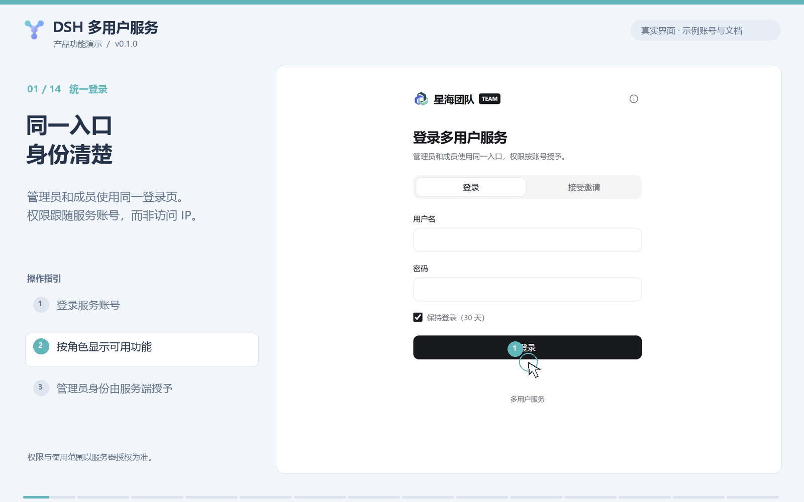

首次设置：个人数据目录与推荐共享目录

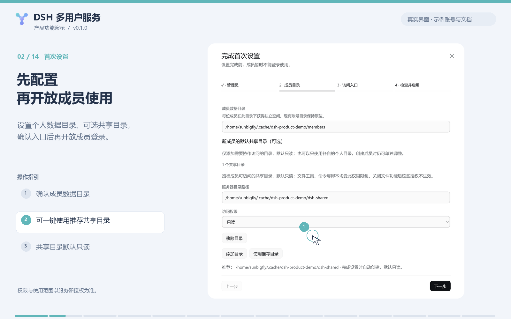

## 03-04 成员与跨页全选

创建或邀请成员，按账号和状态搜索、筛选。表头全选覆盖当前筛选的全部分页：演示中跨两页选中 **13 个账号**，可直接批量设置权限。

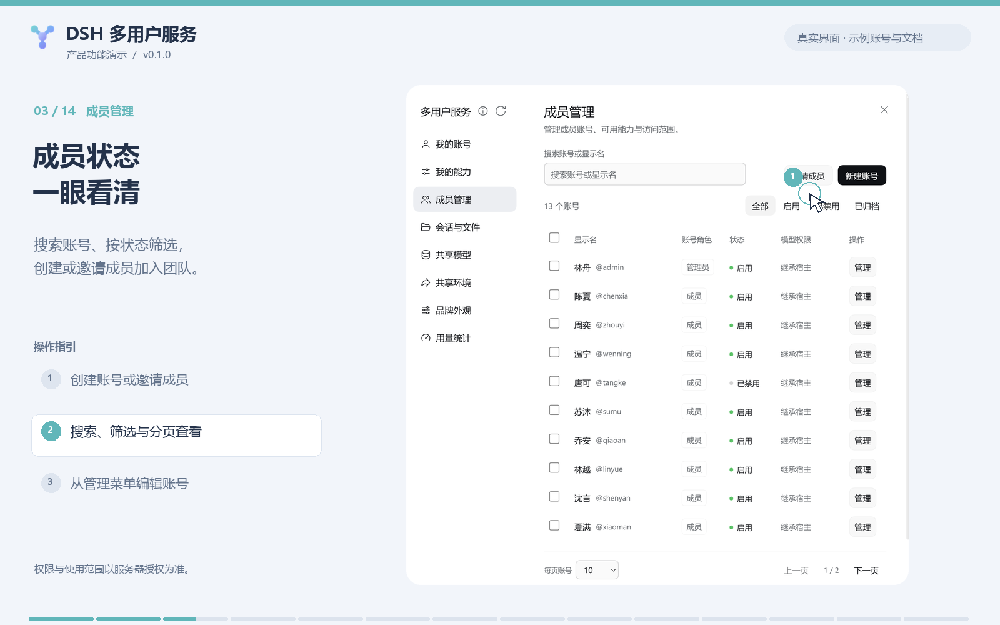

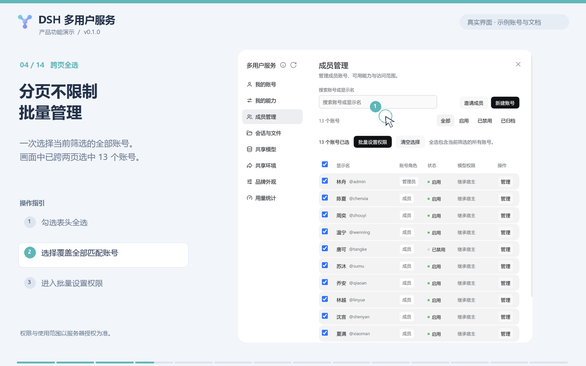

## 05-07 授权与个人偏好

批量更新按模型、能力和目录分范围勾选，只更新选定范围。共享目录可设置只读或读写；成员在管理员授权上限内决定自己的功能启用偏好，个人选择仅影响本人。

批量授权、共享目录与成员个人能力

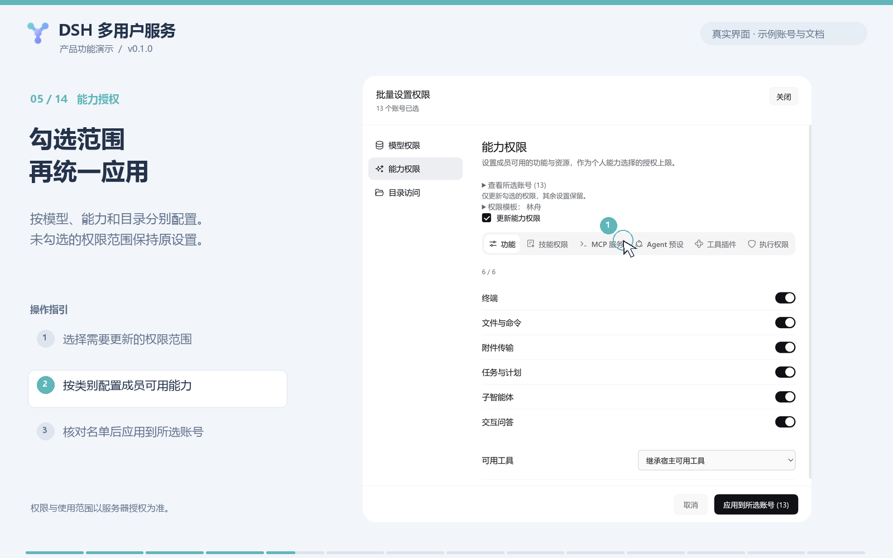

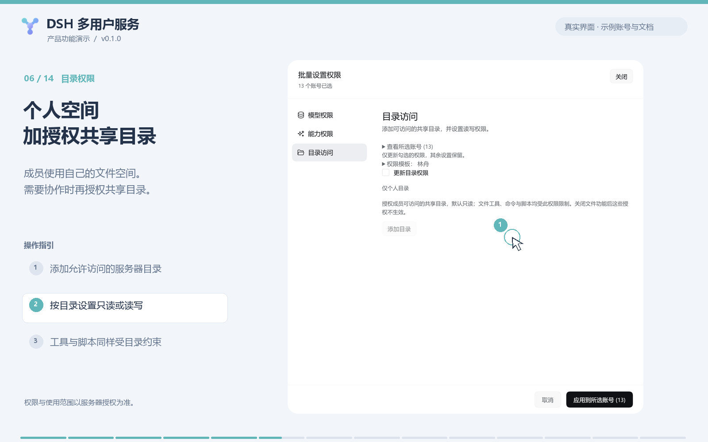

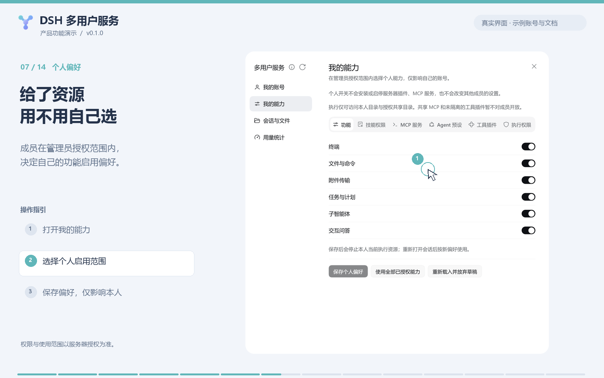

## 08-10 会话与文件

管理员按成员管理内容，成员管理自己的内容。文件可查看、下载、替换、重命名、移动和回收；会话高级筛选可按内容、运行状态、归档状态及日期等条件查询。

文件列表、操作菜单与会话筛选

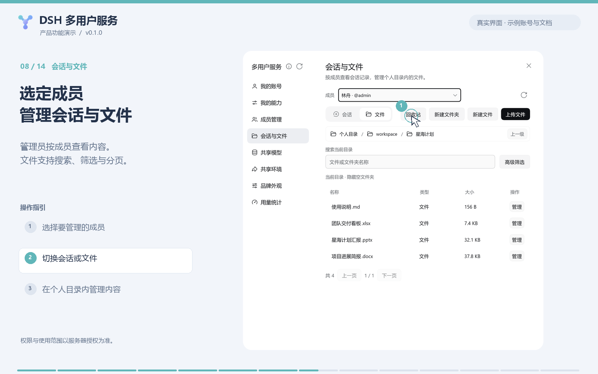

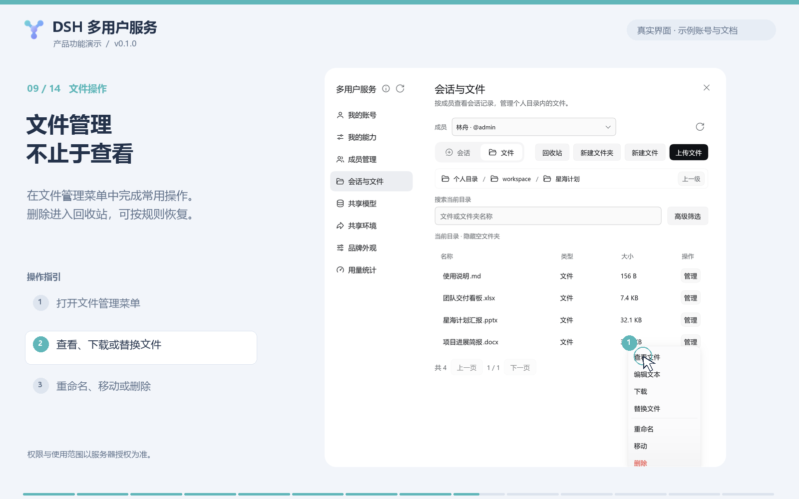

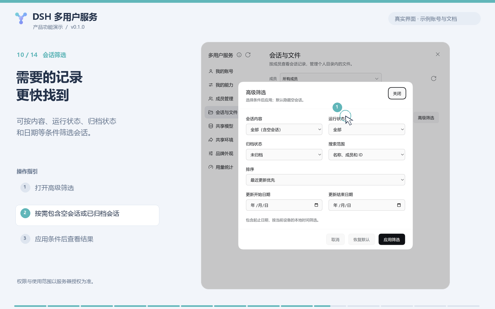

## 11-12 额度与用量

按成员设置并发任务数和每日、每月 tokens 额度。用量表支持搜索、状态筛选与分页；缺少结算数据的调用单独计数，未知值不当作零。

额度配置与用量统计

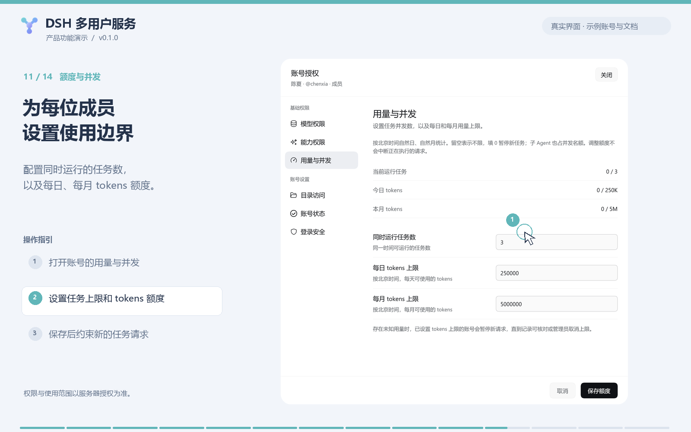

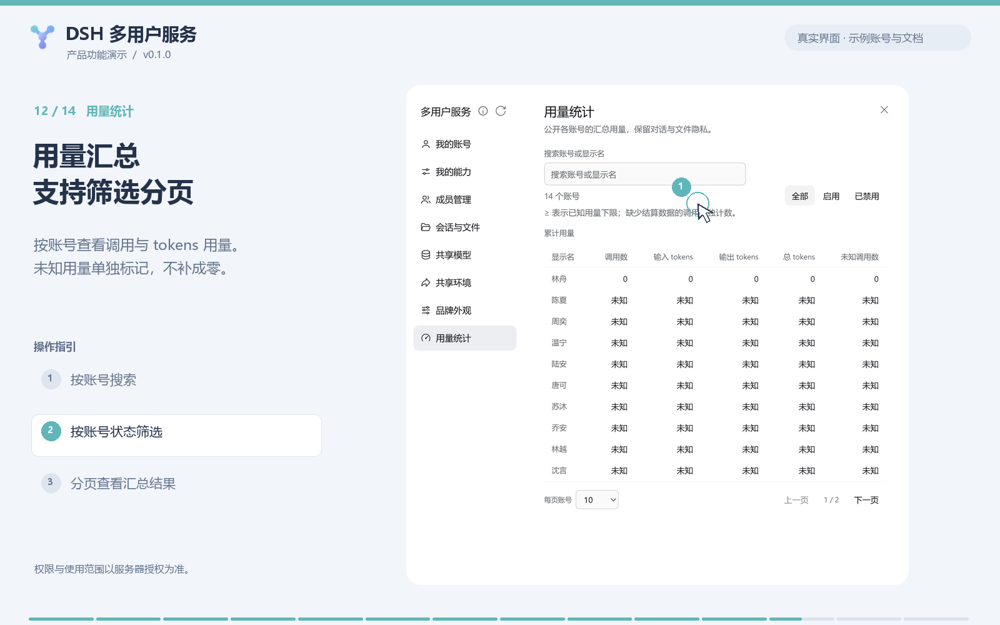

## 13-14 账号归档与品牌

归档账号可恢复，也可在确认后删除；删除账号保留历史会话、文件和用量。共享品牌设置复用于侧栏与登录页。

归档后的操作与团队品牌设置

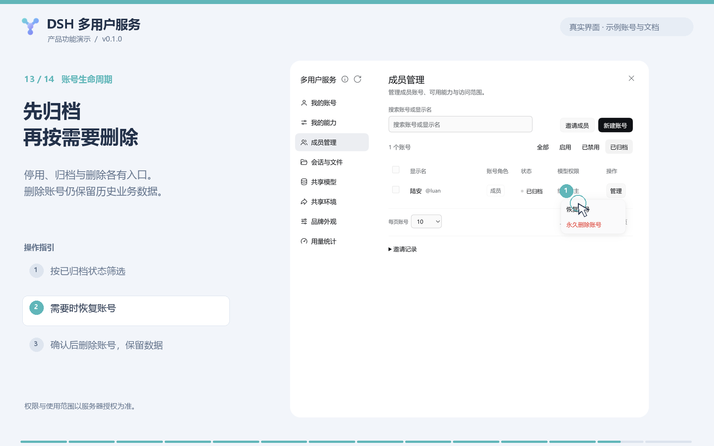

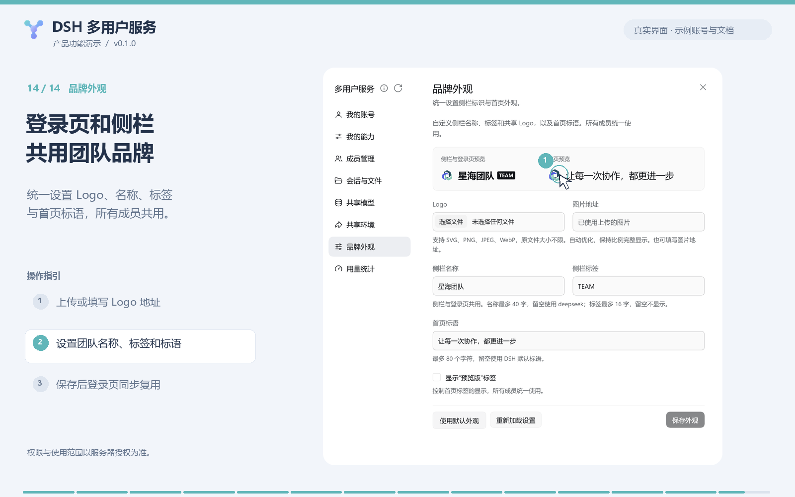

权限与执行边界详见 [产品约定](../../CONTRACT.md#执行与数据边界)。
